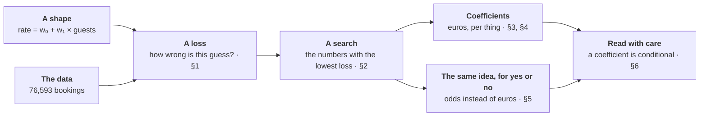

# Week 05 · Fit

!!! abstract "At a glance"
    **Block:** 2 · Models & Optimization
    **Running example:** hotel bookings. *What will this booking pay per night?* and *will it be cancelled?* New to the data? Start with [the dataset](dataset.md).
    **Lab:** [`week-05/lab.ipynb`](https://github.com/evisp/ml-course-labs/blob/main/week-05/lab.ipynb) in the labs repository
    **Before class:** sections 1, 3 and 5, about fifteen minutes

## Why this matters

> A model is a shape and a rule for being wrong. Everything else is search.

For four weeks the model was a detail. Logistic regression appeared because something had to produce a score; a tree appeared because something had to be compared with it. Both were treated as boxes that turn columns into numbers.

This week opens the box, and it turns out to contain very little: a shape with a few unknown numbers in it, and a rule that says how badly a given set of numbers fits the data. Fitting is the search for the numbers that make that rule happiest.

That is worth doing slowly, because a linear model is the only model in this course whose insides you can read in plain language. By section 3 you will be able to say *this booking costs nine euros more because there is an extra adult in it* and point at the number that says so. Nothing in Weeks 6 to 9 lets you do that as cleanly, which is exactly why this week comes first.

## This week at a glance

Sections 1 and 2 work on **the bench**: two numbers, one picture, nothing hidden. Sections 3 to 6 move to **the field**, where the same machinery runs on 76,593 real bookings and starts telling you things you did not know.

## Learning outcomes

By the end of this week you can:

- write a model as a shape plus a loss, and say what each part does
- explain fitting as a search over a surface, and point at where the answer sits
- read a linear coefficient in the units of the thing you are predicting
- say what changes when the loss is absolute error instead of squared error
- read a logistic coefficient as an effect on odds
- explain why a coefficient means nothing on its own

## 1. A shape, and a rule for being wrong { .section-label }

Pick the simplest shape that could possibly work:

\[
\text{rate} = w_0 + w_1 \times \text{guests}
\]

Two unknown numbers. \(w_0\) is what every booking starts at, \(w_1\) is what each guest adds. Choose any two numbers and you have a model — a bad one, probably, but a complete one: give it a booking, it gives you a price.

So you need a way to say how bad. That is the **loss**: one number that scores a whole set of guesses. The usual one squares each mistake and takes the average.

\[
\text{loss}(w_0, w_1) = \frac{1}{n}\sum \big(\text{what it said} - \text{what it was}\big)^2
\]

Squaring does two things. It makes a miss of −10 count the same as a miss of +10, and it makes a miss of 20 count four times as much as a miss of 10, not twice. Section 4 is about whether you want that second one.

!!! hotel "The simplest model of a hotel rate"
    Fitted on the 76,593 training bookings:

    **€42.92 + €27.72 per guest**

    On validation that is R² 0.198 and an average error of **€26.51**. The floor — predicting €97.37 for everyone — was €29.92. So one column, one line of arithmetic, buys you about three euros and fifty cents of accuracy per booking.

    
    

    *Guests are whole numbers, so the points are spread sideways a little to make them visible. The line is doing something real and not very much.*

**Elsewhere:** a shape and a loss is every supervised model there is. What changes between them is how flexible the shape is, and how it searches.

## 2. Fitting is a search { .section-label }

With two unknowns you can see the whole problem. Every pair \((w_0, w_1)\) gives one loss, so the loss is a landscape over all possible models, and fitting means finding its lowest point.

*Darker is lower. The marked point is the fit: there is exactly one lowest point, and it is a bowl, so you cannot get stuck anywhere else.*

For this shape and this loss, the lowest point can be computed directly — there is a formula, and `LinearRegression` uses it. That is a luxury. It stops being true as soon as the shape gets more interesting, and from Week 6 onwards the search has to walk downhill instead of jumping straight to the bottom.

!!! note "Why the bowl matters"
    A bowl has one bottom. Whatever you start from, you end in the same place, and two people fitting the same model on the same data get the same answer.

    Keep that picture. In Week 6 you will see the walk downhill, in Week 7 what happens when the bowl is too easy to reach, and in Week 8 models whose landscape is not a bowl at all.

## 3. What a coefficient says { .section-label }

Add more columns and the shape stays the same idea: one number per thing, added up.

!!! hotel "A model you can read out loud"
    Five numeric columns and four categorical ones, one-hot encoded. On validation: **R² 0.421, average error €21.31**. Against the €29.92 floor, that is nearly a third of the error gone.

    
    

    *Euros a night, holding everything else still.*

    It starts every booking at **€46.60**, then:

    - an extra adult adds **€9.26**, an extra child adds **€14.01**
    - arriving in August adds **€53.67** over January
    - room type H adds **€69.85** over type A
    - a complimentary booking takes off **€47.54**
    - every extra night takes off **€0.32**, and every extra day booked ahead takes off **€0.04**

Three of those are worth stopping on.

**A child costs more than an adult.** €14.01 against €9.26. Not because children are charged more, but because bookings with children are family bookings in family rooms in August. The coefficient has absorbed everything it is standing in for.

**More nights makes it cheaper.** Only thirty-two cents a night, but the sign is the interesting part: longer stays get better rates, which is what you would expect and which a model with no knowledge of hotels has just told you.

**Booking earlier makes it cheaper, barely.** Four cents a day. Over six months that is about €7.

!!! question "Before you read on"
    Write down what you expect the coefficient for *the resort, not the city* to be, and why. Then look at it on the chart. Section 6 explains why your answer and the model's can both be right.

**Elsewhere:** a coefficient is always *per one unit, with everything else held still*. The second half of that sentence is where people get into trouble.

## 4. Squared, or absolute { .section-label }

The loss is a choice, and it is the one choice people forget they made.

Squared error punishes a big miss out of all proportion: twice as far wrong is four times as bad. Absolute error does not — twice as far wrong is twice as bad, and nothing more. Which means a single strange booking can drag a squared-error fit towards itself, and leave an absolute-error fit alone.

!!! hotel "One booking at €5,400"
    The file contains exactly one. `daily_rate()` leaves it out. Here it is put back, alone, among four thousand ordinary bookings.

    
    

    One row in four thousand moved the squared-error line by **€1.06** at the intercept and fourteen cents a guest. The absolute-error line did not move **at all** — not approximately, exactly.

That is the trade in one picture. Squared error is smooth, has a formula, and trusts every row. Absolute error is robust, has no formula, and fits a median rather than a mean.

| | Squared error | Absolute error |
|---|---|---|
| **Fits** | the mean | the median |
| **One extreme row** | moves it | does not |
| **Solving** | a formula | an optimiser |
| **Reach for it when** | the big misses are the ones that hurt | a few strange rows are not your problem |

Neither is correct. They answer different questions, and section 2 of Week 4 is where you decide which question you are being asked.

## 5. The same idea, for yes or no { .section-label }

Cancellation is not a number of euros, it is a yes or a no. The shape cannot stay the same, because \(w_0 + w_1 x\) runs from minus infinity to plus infinity and a probability does not.

So squash it. Compute the straight-line part exactly as before, then push it through a function that turns any number into something between 0 and 1. That is **logistic regression**, and the loss changes to match: instead of squaring the error in euros, it scores how confident the model was about the answer it got.

What comes out the other side is readable too, just in different units. The straight-line part is in **log-odds**, so exponentiating a coefficient gives you a multiplier on the odds.

!!! hotel "What makes a booking cancel"
    Five numeric and four categorical columns. On validation: PR AUC **0.795**, lift **1.99** — twice as good as guessing.

    
    

    *Numeric columns are scaled, so each one is "per one standard deviation".*

    - **non-refundable: ×190** — a booking with a non-refundable deposit has 190 times the odds of cancelling
    - **one more past cancellation: ×10.5**
    - **119 more days ahead: ×1.56**
    - **booked by a company: ×0.39** — corporate bookings are far stickier
    - **one more special request: ×0.54** — asking for something is a sign of intent to turn up

Read these as odds, not probabilities. A multiplier of 2 on odds of 1-in-100 takes you to about 1-in-50. The same multiplier on odds of 1-in-2 takes you to 2-in-3. The effect on the probability depends entirely on where you started.

**Elsewhere:** odds ratios are how medicine and epidemiology report everything. Being able to read one is worth more than being able to derive it.

## 6. A coefficient is conditional { .section-label }

Everything above came with the same five words attached: *holding everything else still*. That clause is doing enormous work, and this section is about what happens when you forget it.

!!! hotel "Non-refundable, twice"
    Alone in a model with nothing else, `deposit_type = Non Refund` multiplies the odds of cancelling by **315.6**.

    In the model from section 5, with lead time and market segment alongside it, the same column multiplies them by **190.3**.

    Same data, same column, same fit. The number moved because the other columns took some of the credit — non-refundable bookings are made on average **242 days ahead** against 100 for the rest, and 61.5% of them come through group channels.

A coefficient is not a property of a column. It is a property of a column *in a particular model*, and it changes when its neighbours change.

The sharper version of the same problem is when one coefficient is asked to describe two different worlds.

*The resort charges €177 a night in August and €47 in November — nearly four times as much. The city barely moves: €104 against €85. The model has one August coefficient and has to use it for both, so it lands between them and is wrong about each.*

The model is not broken. It is answering the question it was asked, which was *what does August add, on average, across both hotels*. If you want it to know that August means something different by the sea, you have to say so — by giving it an interaction, or by fitting the two hotels separately. Week 8's trees find that kind of thing without being told, which is most of why they exist.

!!! warning "Three ways to misread a coefficient"
    **As a cause.** Children do not cost €14.01. Bookings with children cost €14.01 more than otherwise-identical bookings without them, in this data.

    **As stable.** Add a column, every other coefficient moves.

    **As comparable.** A coefficient is per unit, and the units differ. One night, one child and one euro of lead time are not the same size of step. Scaling the inputs is how you make them comparable, which is section 3 of Week 6.

## 7. What this buys, and what it does not { .section-label }

| | Rate (track A) | Cancellation (track B) |
|---|---|---|
| **Floor** | €29.92 average error | lift 1.00 |
| **One column** | €26.51 | — |
| **This week's model** | **€21.31**, R² 0.421 | **lift 1.99**, PR AUC 0.795 |

Both models clear the floor comfortably, and both are readable from end to end — which is the whole point of starting here. You can take either one to a hotel manager and defend every number in it.

What they cannot do is bend. A linear model says each thing is worth the same amount everywhere: August adds €53.67 whether you are by the sea or in the city, and a day of lead time removes four cents whether it is the first or the three-hundredth. Every limitation in the rest of this block is a variation on that sentence, and every model in Weeks 7 and 8 is an attempt to escape it.

!!! project "In the lab"
    1. Fit the two-number model yourself and find the same €42.92 and €27.72 — once with `LinearRegression`, once by writing the loss and searching a grid, so the formula stops being magic.
    2. Build the readable model and read five coefficients out loud in euros.
    3. Put the €5,400 booking back and measure what each loss does about it.
    4. Fit the cancellation model and convert its coefficients into odds multipliers.
    5. Fit the resort and the city separately, and show what the pooled August coefficient was hiding.
    6. Write the five sentences your model would let you say to a manager, and one it would not.

## Summary

A model is a shape and a loss. Fitting searches the loss landscape for its lowest point, and for a linear model with squared error that landscape is a bowl with a formula for the bottom.

A linear coefficient is readable in the units of the answer — euros a night, or a multiplier on odds — which makes this the one week where you can see all the way through a model. But every coefficient carries *holding everything else still* with it, and when one coefficient has to describe two different worlds, it lands between them and is wrong about both.

**Next week:** the formula goes away. When you cannot jump to the bottom of the bowl, you have to walk, and walking can fail in three visible ways.

## Resources

- [scikit-learn: linear models](https://scikit-learn.org/stable/modules/linear_model.html) — `LinearRegression`, `LogisticRegression`, `QuantileRegressor`
- [Calculus for ML](../06-reference/calculus.md) — what a derivative of a loss means, and why a bowl is convenient
- [Choosing a metric](../06-reference/metrics.md) — R², MAE and when each one lies
- [The dataset](dataset.md) — the splits, the floors and what the columns mean
