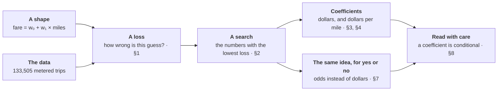

# Week 05 · Linear models

!!! abstract "At a glance"
    **Block:** 2 · Models & Optimization
    **Running example:** New York taxi trips. *What will this trip cost?* and *will it crawl?* New to the data? Start with the [Block 2 overview](index.md).
    **Lab:** [`week-05/lab.ipynb`](https://github.com/evisp/ml-course-labs/blob/main/week-05/lab.ipynb) in the labs repository
    **Before class:** read sections 1, 3 and 5, about fifteen minutes

## Why this matters

> A model is a shape and a rule for being wrong. Everything else is search.

For four weeks the model was a detail. Logistic regression appeared because something had to produce a score; a tree appeared because something had to be compared with it. Both were treated as boxes that turn columns into numbers.

This week opens the box, and it turns out to contain very little: a shape with a few unknown numbers in it, and a rule that says how badly a given set of numbers fits the data. Fitting is the search for the numbers that make that rule happiest.

What makes this worth doing on taxi fares is that New York publishes the answer. The meter's rate is a public document, so for once you can fit a model and then check it against the rule that generated the data.

## This week at a glance



Sections 1 and 2 define what a model is. Sections 3 to 6 read one. Sections 7 and 8 do the same for a classifier, and find a coefficient that misleads.

## Learning outcomes

By the end of this week you can:

- [ ] Say what a model is, in terms of a shape and a loss
- [ ] Write a loss function, and explain what fitting searches for
- [ ] Read a linear model's coefficients in the units of the problem
- [ ] Explain why a coefficient changes when other features are added
- [ ] Choose between squared and absolute error, and defend the choice
- [ ] Tell an explanatory model from a predictive one
- [ ] Fit logistic regression and read its coefficients as odds
- [ ] Explain why no coefficient should be read on its own

## Before class

!!! question "Bring an answer"
    A taxi meter charges a fixed amount when you get in, then by the mile. If you fit a straight line to real fares, would you expect the fitted starting charge to be higher or lower than the real one? Why?

---

## 1. A model is a shape and a loss

Two decisions define a model.

**The shape** says what form the answer may take. For a straight line through fares:

\[
\hat{y} = w_0 + w_1 x
\]

The model is those two numbers. Everything the data will ever tell us has to be squeezed into them.

**The loss** says what counts as a mistake. The most common choice is the mean squared error:

\[
\text{MSE} = \frac{1}{n}\sum_{i=1}^{n}\left(y_i - \hat{y}_i\right)^2
\]

Squaring keeps errors from cancelling, and punishes a large miss far more than several small ones. It is a choice, not a law, and section 5 changes it.

Once both are fixed, **fitting** is a search: of all the lines this shape allows, which has the lowest loss?


*Every point in this plane is a candidate line, and the contours are its loss. The search is for the bottom of the bowl. The published meter sits nearby, but not at the bottom, which section 3 explains.*

!!! note "Key insight"
    **Fitting is not magic, it is minimisation.** Change the shape and you change what the model can express. Change the loss and you change which mistakes it refuses to make.

*Elsewhere:* the same two decisions describe almost every model in this course. A decision tree's shape is a set of rules, a neural network's is a stack of layers, and each comes with a loss that defines what it is trying to avoid.
{ .elsewhere }

## 2. Fitting is a search, sometimes a shortcut

For least squares with a linear shape, the search has a closed-form answer: a formula gives the best coefficients directly, no iteration, in a few milliseconds. `LinearRegression` uses it.

That is a special case, and a lucky one. The moment you change the loss, add a penalty, or move to logistic regression, no such formula exists, and the only way to find the minimum is to walk downhill from a starting guess. That walk is Week 6.

!!! taxi "In our example"
    Fitted on May's 133,505 standard metered trips, the best straight line through the fares is

    **fare ≈ $6.73 + $3.97 per mile**

    Compare that with the published rate: a **$3.00** initial charge and **$3.50** a mile. Our line charges more than double at the door, and 13% more per mile, yet it is provably the best line of its shape. The next section explains why.

## 3. Coefficients are readable, and worth reading

A coefficient is the model's answer to a specific question: *how much does the prediction change when this feature increases by one, with everything else in the model held fixed?* In a fare model, $w_1$ is dollars per mile. That is what makes linear models worth teaching long after fancier ones exist: you can read what they believe, and argue with it.

Reading them correctly means remembering the second half of that sentence. **With everything else held fixed** is doing a lot of work, and when the model cannot see something that matters, its coefficients quietly absorb it.

!!! taxi "In our example"
    The meter charges **$0.70 a minute whenever the taxi is below 12 mph**. Our model cannot see minutes, so every dollar earned by sitting in traffic has to be explained by the only columns it has: the starting charge and the distance. Both inflate.

    If that is the explanation, trips that never slowed down should fit the published rate far better. They do.

    
    

    | Fitted on | Starting charge | Per mile |
    |---|--:|--:|
    | The published meter | $3.00 | $3.50 |
    | All trips | $6.73 | $3.97 |
    | Free-flowing trips, over 12 mph (27,863) | **$3.93** | **$3.95** |
    | Slow trips, 12 mph or less (105,642) | $4.92 | $5.42 |

    The free-flowing fit lands near the real tariff. Even those trips wait at some lights, which is why it is not exact. The slow trips charge $5.42 a mile because on those journeys much of the fare was bought with minutes, and the model has to call it distance.

*Elsewhere:* in a salary model without a seniority column, the coefficient on years of education absorbs part of the effect of seniority, because the two travel together. The number is not wrong; it is answering a question that includes everything the model cannot see.
{ .elsewhere }

!!! project "In your project"
    Fit the simplest version of your model, with two or three features, and write out what each coefficient claims in the units of your problem. If a number looks wrong, ask what the model cannot see.

## 4. Explaining is not predicting

If the missing time charge distorts the coefficients, why not add the duration as a feature?

Because the answer depends on what the model is *for*.

- An **explanatory** model answers *what drives this outcome?* It may use anything that was measured, whenever it was measured.
- A **predictive** model answers *what will happen?* It may only use what is known at the moment it is asked.

Both are legitimate science. Confusing them is how a beautiful notebook becomes a model that cannot be deployed.

!!! taxi "In our example"
    Add the duration and the meter appears almost exactly:

    **fare ≈ \$2.36 + \$2.50 per mile + \$0.52 per minute**, against the published **\$3.00 + \$3.50 + \$0.70**.

    Training error falls by more than 90%. The model has recovered the rule that generated its data from nothing but receipts, which is a genuinely satisfying result.

    And it is useless for the booking app, because at the moment of booking the duration does not exist. Week 1's test rules it out, and the fare model goes back to what a passenger can be told before they travel.

!!! note "Key insight"
    **A model that explains the past perfectly can be unusable for predicting the future.** The question is never only "does it fit?" but "will its inputs exist when I need an answer?"

*Elsewhere:* a hospital model that explains length of stay using the discharge diagnosis is excellent science and worthless for planning beds, because the diagnosis is confirmed at discharge.
{ .elsewhere }

!!! project "In your project"
    Write one sentence saying whether your model is explanatory or predictive. Then check every feature against that sentence.

## 5. The loss is a decision

Squared error is a default, not a law, and it has a personality: because it squares, a $40 miss contributes four hundred times as much as a $2 miss, so a handful of unusual cases can pull the whole model towards them.

**Absolute error** treats a $40 miss as twenty times a $2 miss:

\[
\text{MAE} = \frac{1}{n}\sum_{i=1}^{n}\left|y_i - \hat{y}_i\right|
\]

Each loss produces the model that is best *by its own standard*. That is not a trick: it is what fitting means.

| Choose squared error when | Choose absolute error when |
|---|---|
| Large misses are disproportionately costly | Every unit of error costs the same |
| You want the model to attend to extremes | A few unusual cases should not steer the line |
| You need the closed-form solution's speed | You can afford an iterative fit |

!!! taxi "In our example"
    The same 8,000 trips, fitted twice. Eight of them cost over $100.

    
    

    | Loss | Fitted line | Validation MAE | Validation RMSE |
    |---|---|--:|--:|
    | Squared error | $6.63 + $4.00 per mile | 2.98 | **4.20** |
    | Absolute error | $5.36 + $4.10 per mile | **2.84** | 4.33 |

    Each wins on its own metric, and the lines differ most at the left edge, where the starting charge is $1.27 apart. On a short trip, that dollar is a large share of the fare, so the choice of loss is a choice about which passengers get the better quote.

*Elsewhere:* in demand forecasting, under-stocking and over-stocking rarely cost the same. A loss that treats them symmetrically is already the wrong model, however well it fits.
{ .elsewhere }

!!! project "In your project"
    State which loss your model minimises, and why that matches the cost of being wrong in your problem. If it does not, say so.

## 6. More features, same arithmetic

A line in one variable becomes a plane, then a shape nobody can picture. The formula is unchanged: every feature gets a weight, and the prediction is their sum.

\[
\hat{y} = w_0 + w_1x_1 + w_2x_2 + \dots + w_px_p
\]

Two practical points follow.

**Categories need columns.** One-hot encoding gives each value its own weight, which is what lets the model say "2pm adds two dollars" rather than pretending that hour 14 is twice hour 7.

**Scaling changes the units of a coefficient, not the model.** After standardising, a coefficient reads as "dollars per standard deviation", which makes features comparable with each other but no longer in their original units. Decide which you want before reading the numbers.

!!! taxi "In our example"
    Adding the airport flag, the hour and the weekday takes the model to 33 columns and the validation error from $3.00 to $2.76. The hourly weights draw the city's traffic:

    
    

    *For the same trip, midday costs about $2 more than 5am. The model has never been told about rush hour. It inferred the shape from fares.*

!!! project "In your project"
    Encode your categorical features and plot the weights of one of them. If the pattern contradicts what you know about the domain, find out why before trusting the model.

## 7. The same idea, for a yes or no question

A straight line is the wrong shape for a probability: it runs off to infinity in both directions, and a probability must stay between 0 and 1. **Logistic regression** keeps the linear part and squashes the result:

\[
P(y = 1) = \sigma\left(w_0 + w_1x_1 + \dots\right), \qquad \sigma(z) = \frac{1}{1 + e^{-z}}
\]

The loss changes too. Squared error is a poor match for a yes-or-no outcome, so logistic regression minimises **log loss**, which punishes confident mistakes hardest. Log loss has no closed-form minimum, which is the first practical reason to care about the search itself, and the subject of Week 6.

Its coefficients are no longer dollars. They add to the **log-odds**, so exponentiating one turns it into a multiplier on the odds: $e^{w} = 2$ means "doubles the odds".

!!! taxi "In our example"
    The crawl question, from Project 1: will this trip average under 6 mph? Fitted on distance, the airport flag, the hour and the pickup borough, it reaches a validation ROC AUC of **0.814**.

    
    

    *Picked up at 2pm, the odds of crawling are about three times the average hour's. At 4am they are a sixth. Each extra standard deviation of distance cuts them to a sixteenth, because long trips spend most of their miles moving.*

*Elsewhere:* a credit model's coefficient of 0.41 on a risk flag means that flag multiplies the odds of default by about 1.5. Regulators often ask for exactly this reading, which is why logistic regression survives in lending long after better-scoring models exist.
{ .elsewhere }

!!! project "In your project"
    If your question is a classification, report your model's coefficients as odds multipliers, with one sentence each in plain language.

## 8. No coefficient should be read alone

A coefficient answers a conditional question, and the condition is *everything else in the model*. Add a feature that overlaps with an existing one and the existing weight will move, sometimes a lot, sometimes through zero.

!!! taxi "In our example"
    In the crawl model, a Manhattan pickup **lowers** the predicted odds of crawling, by a factor of 0.45. In the borough where traffic is worst.

    
    

    *On its own, 21.9% of Manhattan trips crawl, the highest of any borough with enough trips to judge. Inside the model, its coefficient is below one.*

    Both are true. Manhattan trips are short, and short trips crawl far more often, so distance has already accounted for the risk. What is left for the borough to explain is slightly *less* crawling than its distances alone would suggest.

!!! danger "The sentence to remember"
    A coefficient means **"the effect of this feature, given everything else in the model"**. It is not the effect of the feature in the world. If you want that, measure it on its own, as the left panel does.

*Elsewhere:* this is the mechanism behind many published findings that reverse when a control variable is added. The data did not change, the question did.
{ .elsewhere }

!!! project "In your project"
    Pick your most interesting coefficient and check it against the raw relationship in the data. If they disagree, explain why in your report. That explanation is worth more than the model.

---

## Lab

!!! example "Lab · `week-05/lab.ipynb`"
    In the [labs repository](https://github.com/evisp/ml-course-labs). The lab samples 50,000 trips per split so everything runs in seconds; the numbers on this page come from the full months and land within a few cents.

    1. `git pull`, open `week-05/lab.ipynb`, save your own copy as `my-lab.ipynb`
    2. Write the loss function, and score three candidate lines with it
    3. Fit the fare, and compare your two numbers with the published meter
    4. Prove why they differ, using the free-flowing trips
    5. Recover the meter by adding the duration, then throw that model away
    6. Refit with absolute error, and see which model each metric prefers
    7. Fit logistic regression on the crawl, and read its coefficients as odds
    8. Explain the Manhattan coefficient to a colleague who misread it

## Project step

!!! project "For your Project 2 dataset"
    - Fit the simplest linear or logistic model you can, and write out what each coefficient claims in your problem's units
    - Say whether your model explains or predicts, and check every feature against that
    - State the loss you are minimising, and why it matches the cost of being wrong
    - Check one coefficient against the raw relationship, and explain any disagreement

## Common mistakes

!!! warning "What goes wrong in week five"
    - **Reading a coefficient as an effect in the world.** It is an effect inside a model, given everything else in it.
    - **Comparing coefficients across differently scaled features.** Scale first, or compare in original units knowingly.
    - **Using a feature that explains beautifully and does not exist at prediction time.** The duration, the fare, the outcome's cousins.
    - **Accepting squared error without thinking.** It is a statement about which mistakes hurt most.
    - **Judging a model by its training loss.** That number only says the search worked, not that the model is any good.
    - **Dropping a feature because its coefficient is near zero.** With correlated features, the weight may simply have moved next door.

## Check yourself

??? question "Our fitted line charges $6.73 at the door, the real meter $3.00. Is the model wrong?"
    No. It is the best line of its shape, and the shape has no column for time. The meter also charges $0.70 a minute in slow traffic, and in a distance-only model those dollars must be explained by the starting charge and the per-mile rate, inflating both. Fitted only on free-flowing trips, where little time is charged, the model returns $3.93 and $3.95 a mile.

??? question "You add a feature and another coefficient halves. What happened, and is it a problem?"
    The two features share information, so the explanation that was carried by one is now split between them. It is not a bug, and it is not necessarily a problem, but it means neither coefficient can be read as that feature's effect on its own. Report what the model is, and do not over-claim.

??? question "When would you prefer absolute error to squared error for a price model?"
    When every dollar of error costs the same, and a few unusual trips should not steer the quote for ordinary ones. Squared error is the better choice when a large miss is disproportionately costly, for example when an underestimate loses the customer entirely.

??? question "A logistic coefficient is 0.69. What does that mean in plain language?"
    Its odds multiplier is about 2, so a one-unit increase in that feature roughly doubles the odds of a positive outcome, with everything else in the model held fixed. Doubling the odds is not doubling the probability: from 10% it moves to about 18%, not 20%.

??? question "Why does logistic regression need the search that linear regression can skip?"
    Least squares with a linear shape has a closed-form solution: a formula gives the best coefficients directly. Log loss does not. The only way to its minimum is to start somewhere and walk downhill, which is what Week 6 builds.

## Quick reference

| Idea | In one line |
|---|---|
| A model | A shape, plus a loss that says what counts as a mistake |
| Fitting | The search for the parameters with the lowest loss |
| Coefficient | The change in the prediction per unit of the feature, with everything else held fixed |
| Squared error | Punishes large misses hardest. Closed-form solution. |
| Absolute error | Treats every unit of error alike. Needs an iterative fit. |
| Explanatory vs predictive | What drives this? versus what will happen? Different rules about features. |
| Logistic regression | Linear part, squashed into a probability, fitted with log loss |
| Odds multiplier | $e^{w}$. Two means "doubles the odds". |

```python
LinearRegression().fit(X, y)                       # closed form, squared error
QuantileRegressor(quantile=0.5, alpha=0).fit(X, y) # iterative, absolute error
LogisticRegression(max_iter=2000).fit(X, y)        # iterative, log loss
np.exp(model.coef_)                                 # log-odds to odds multipliers
```

## Summary

A model is a shape and a loss, and fitting is the search for the parameters that make the loss smallest. Linear models earn their place because that search has a closed-form answer and because the result can be read: our fare model says $6.73 at the door and $3.97 a mile, against a published $3.00 and $3.50, and the difference is the time charge it cannot see. Add the duration and the real tariff appears, in a model that can explain fares but never quote one. Change the loss and the line moves, because each loss defines its own idea of a good answer. Logistic regression applies the same idea to a yes-or-no question, with coefficients that read as odds, and ends with a warning: Manhattan looks safe inside a model that already knows the distance, and is the most crawl-prone borough outside it.

**Next week** takes the search itself seriously. Log loss has no formula, so the parameters must be found by walking downhill, and that walk can diverge, stall, or arrive, depending on one number.

**Next:** [Week 06 · Optimization](week-06-optimization.md)

## Resources

- [NYC TLC taxi fare rates](https://www.nyc.gov/site/tlc/passengers/taxi-fare.page). The published meter, worth reading once against your own coefficients.
- [scikit-learn, Linear models](https://scikit-learn.org/stable/modules/linear_model.html). The family, from ordinary least squares to the regularized versions in Week 7.
- [Calculus for ML](../06-reference/calculus.md) on this site, for what a gradient is before Week 6 needs it.
- [Linear algebra](../06-reference/linear-algebra.md) on this site, for the closed-form solution's matrix form.

!!! quote
    Read the coefficients, and remember what they were conditioned on.
